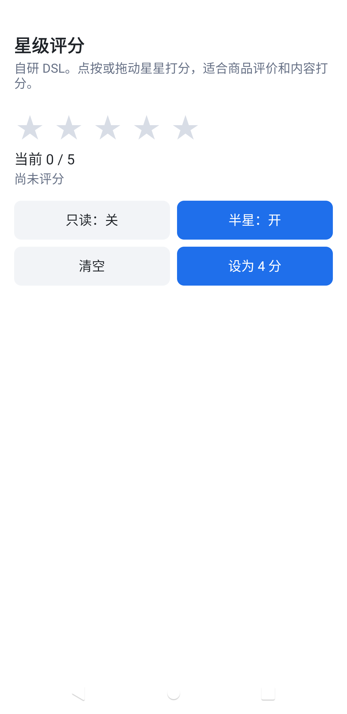
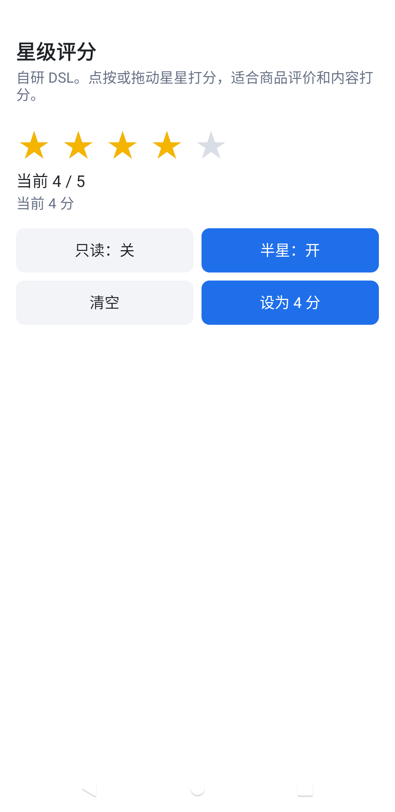

# KuiklyStarRating

Kuikly 星级评分，用于商品评价和内容打分。自研 DSL 与 Compose DSL 都能用。

作者：[@FooWrites](https://github.com/FooWrites)

## 效果

<table>
  <tr>
    <td></td>
    <td></td>
  </tr>
  <tr>
    <td align="center">零分</td>
    <td align="center">已评分</td>
  </tr>
</table>

## 安装

```kotlin
repositories {
    mavenCentral()
    maven("https://jitpack.io")
}
```

自研 DSL：

```kotlin
implementation("com.github.FooWrites.KuiklyStarRating:starrating:v0.1.0")
```

Compose DSL：

```kotlin
implementation("com.github.FooWrites.KuiklyStarRating:starrating-compose:v0.1.0")
```

`starrating-compose` 已传递依赖 `starrating`。本库基于 Kotlin 2.1.21 / Kuikly 2.4.2-2.0.21 构建，不发布到 Maven Central。

JitPack 只发布 `:starrating` 与 `:starrating-compose`。`:demo` 和 `:androidApp` 不在发布坐标里。

## 模块

| 模块 | 发布 | 说明 |
| --- | --- | --- |
| `:starrating` | 是 | 自研 DSL |
| `:starrating-compose` | 是 | Compose DSL。用 Compose 布局绘制，计算与自研 DSL 共用 |
| `:demo` | 否 | 示例页 `star_rating_demo`、`star_rating_compose_demo` |
| `:androidApp` | 否 | 本地 Android 示例宿主，默认打开 `star_rating_demo` |

## 自研 DSL

```kotlin
StarRating {
    ref { ratingRef = it }
    attr {
        maxStars(5)
        rating(0f)
        allowHalf(true)
        readOnly(false)
        starSize(28f)
        starSpacing(6f)
        activeColor(Color(0xFFF5B400L))
        inactiveColor(Color(0xFFD8DDE6L))
    }
    event {
        onRate { value ->
            // 用户点按或拖动后的评分，半星时为 0.5 的倍数
        }
    }
}

ratingRef.view?.setRating(4f)
ratingRef.view?.clear()
```

颜色用 `com.tencent.kuikly.core.base.Color`。默认 5 颗星、星宽 28、间距 6，组件按星数撑开宽高。调用方如果写了 `width` / `height`，之后改星数或星宽不会覆盖这两个值。`readOnly(true)` 只展示，不吃掉父级点击。`allowHalf(false)` 时按整星展示。滑出左边界为 0 分。

`rating` 保存调用方传入的原始值，星星上画的是取整结果。半星开关或星数变化让展示值改变时，回调一次 `onRate`，参数是新的展示值；把这个值写回 `rating` 不会再次回调。组件第一次出现时不回调。按下和拖动只预览，松手才提交，展示值有变化才回调一次。手势取消则回到按下前的展示，不回调。`setRating` / `clear` 也只在展示值变化时回调，调用方需要把回调写回 `rating`。

## Compose DSL

```kotlin
val controller = remember { StarRatingController() }
var rating by remember { mutableStateOf(0f) }

StarRating(
    maxStars = 5,
    rating = rating,
    allowHalf = true,
    readOnly = false,
    starSize = 28f,
    starSpacing = 6f,
    onRate = { value -> rating = value },
    controller = controller,
)

controller.setRating(4f)
controller.clear()
```

`starSize` / `starSpacing` 的单位是 dp。组件默认按星数 × 星宽测量，不撑满父约束；滚动方向没有上界时也按内容尺寸。`modifier` 上的宽高会覆盖这个默认尺寸。取值、预览和 `onRate` 与自研 DSL 相同。

`StarRatingController.setRating` / `clear` 在组合还没挂上时会先记住，挂上后补一次 `onRate`。页面离开组合后不再回调。控制器改分同样要在 `onRate` 里写回 `rating`。

## sDynamic

绘制都在 `commonMain`。自研 DSL 用 Kuikly `View` / `Text` 排 ★。Compose DSL 用 Compose 的 `Row` / `Box` / `Text` 排 ★，不把 `StarRatingView` 放进 `MakeKuiklyComposeNode`。没有 Android / iOS 原生 View，也没有 CocoaPods 依赖。可以按 sDynamic 组件接入。

## 示例

`:demo` 两页：

- `star_rating_demo`：自研 DSL，从 0 分开始，可切换只读、半星，清空或设为 4 分
- `star_rating_compose_demo`：Compose DSL

本地 Android 宿主（不发布）：

```bash
./gradlew :androidApp:assembleDebug
```

`applicationId` 为 `com.foowrites.kuikly.starrating.host`，启动页是 `star_rating_demo`。需要 JDK 17 和 Android SDK 34。

## 许可

Apache License 2.0

Copyright (c) 2026 FooWrites
